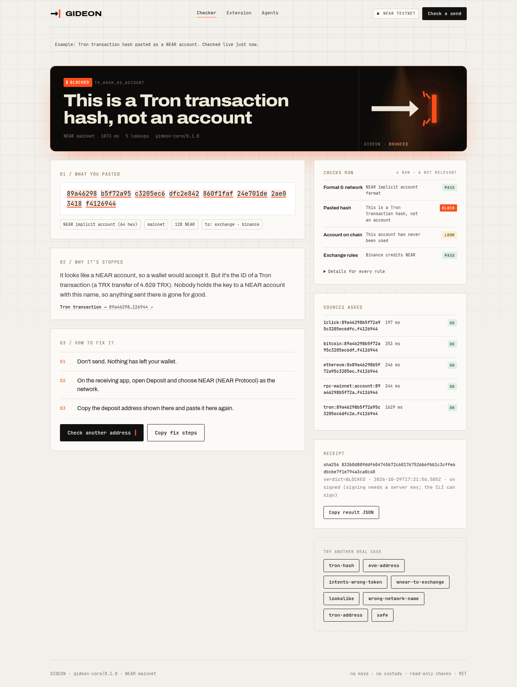
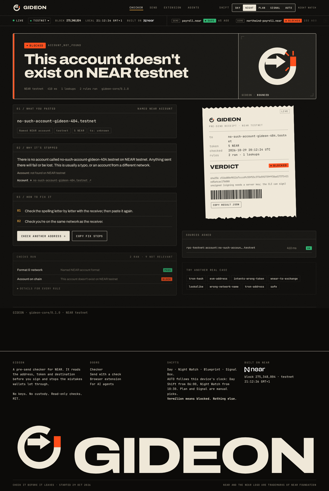
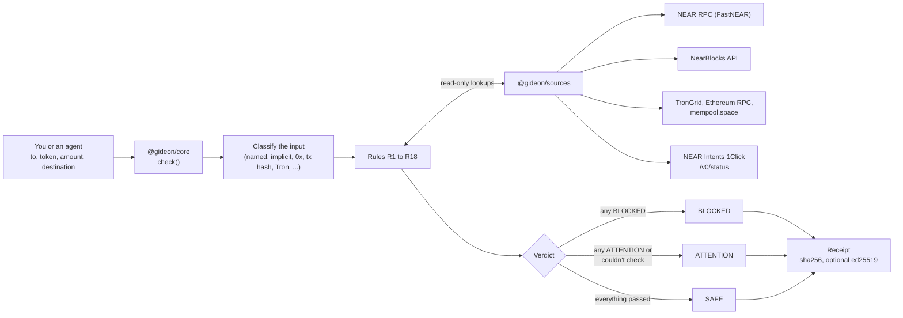
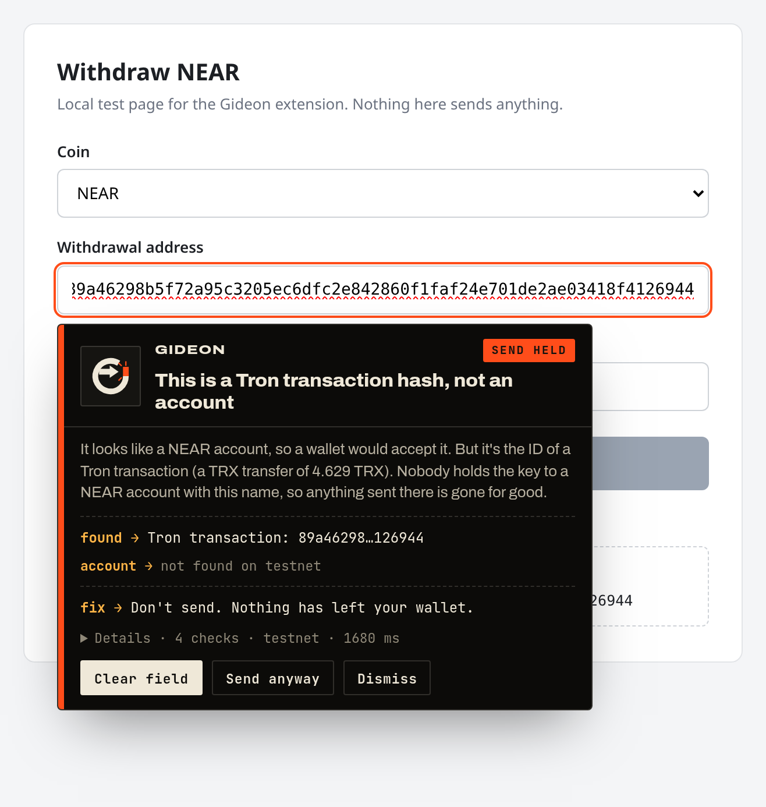
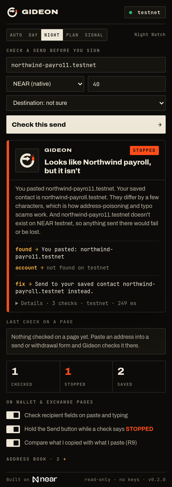
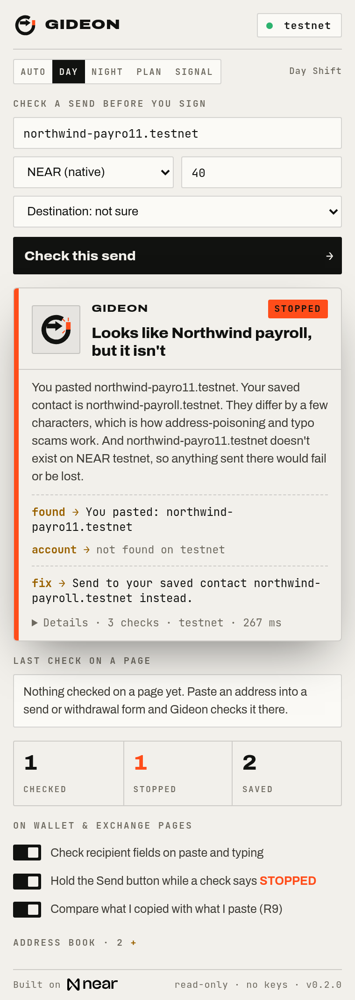
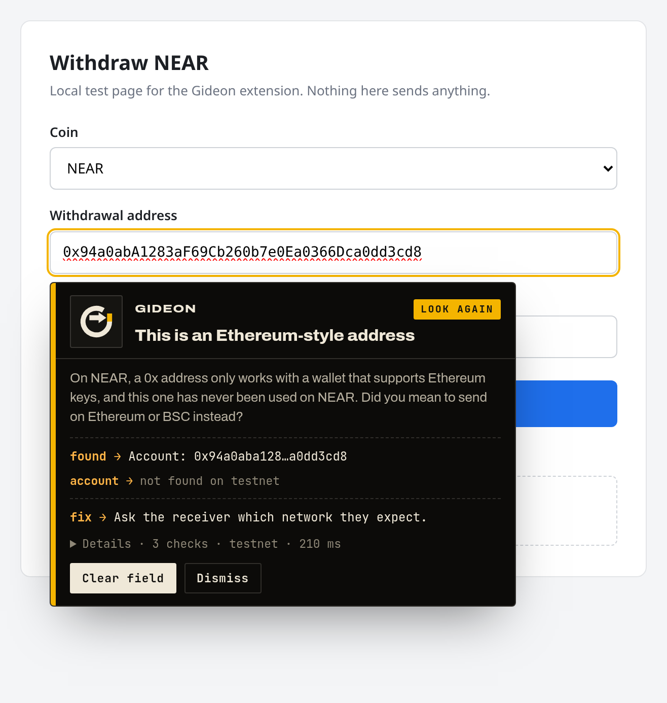
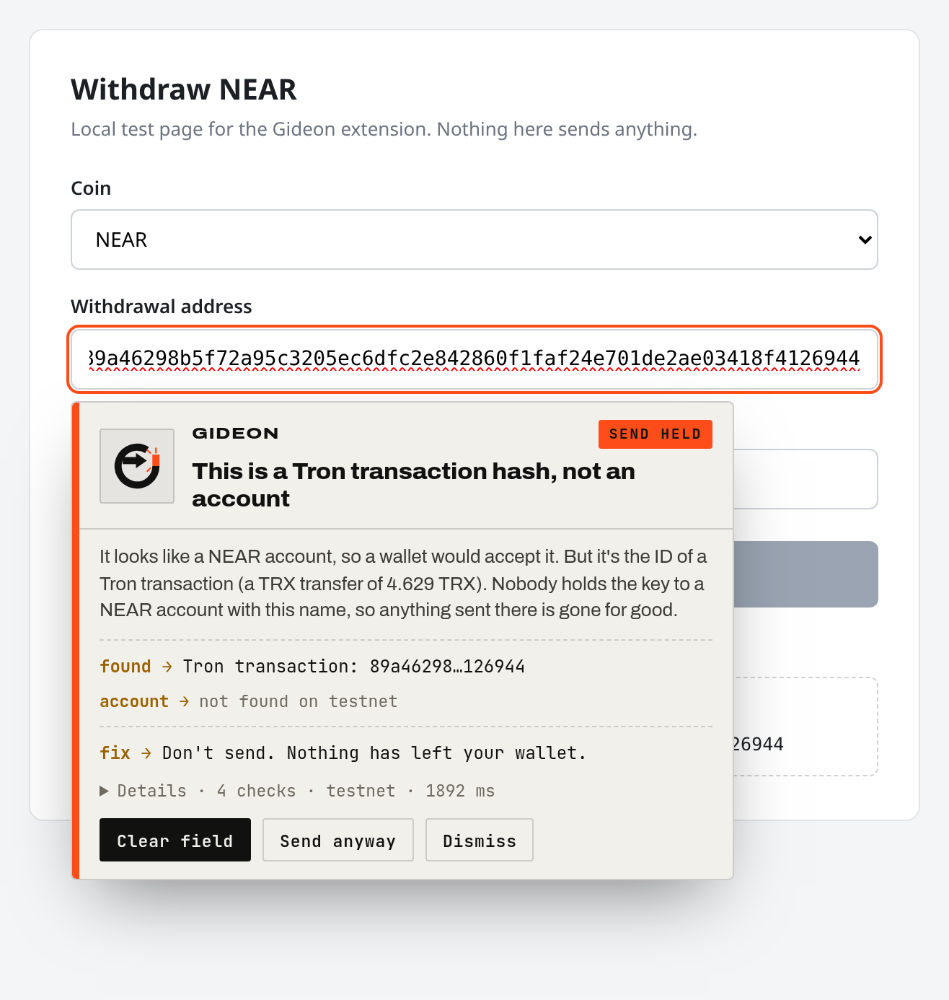
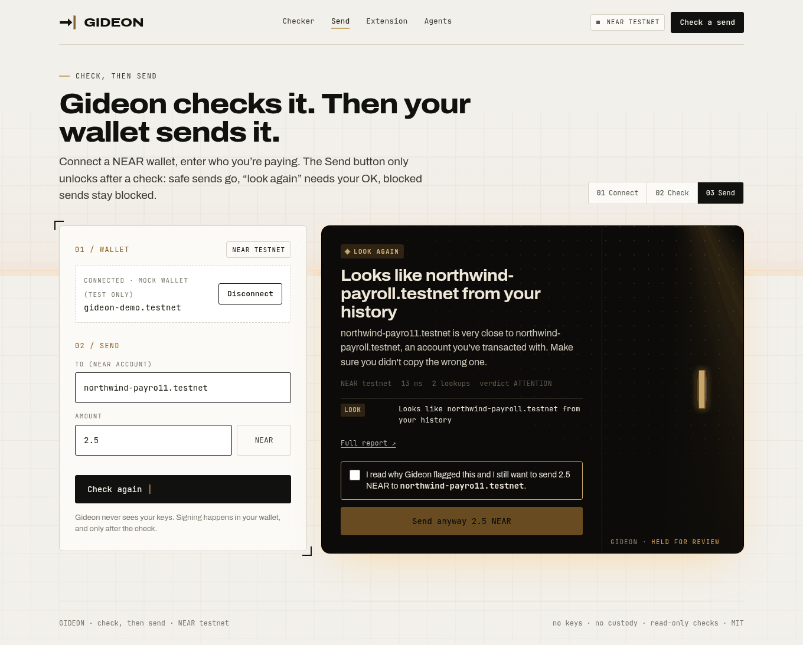
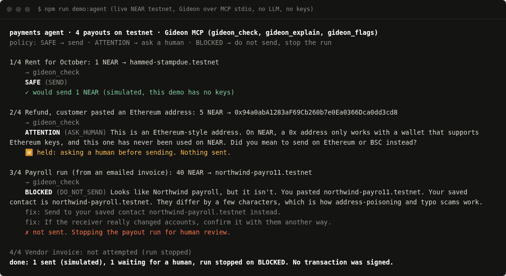

<p></p>

# Gideon

**A pre-send safety check for NEAR.** Paste the address, token and
destination you're about to send to. Gideon checks them against live,
public chain data and says **BLOCKED**, **ATTENTION** or **SAFE**, with the
reason in plain words and how to fix it. Gideon never sees keys and never
holds funds. On the website's **Send** page your own NEAR wallet signs the
transfer, and only after the check.

Work began 29 Oct 2026.



## What it catches

| Mistake | Example | Verdict |
| --- | --- | --- |
| An account that doesn't exist | `guest-bok.testnet` (typo of `guest-book.testnet`), or a name that only exists on the other network | BLOCKED |
| A transaction hash pasted as an account | a Tron tx hash looks like a 64-hex NEAR implicit account, and wallets accept it | BLOCKED |
| Wrong network | a `.near` name while sending on testnet, or a Tron `T…` address | BLOCKED |
| Wrong token for an Intents deposit | sending wNEAR to a 1Click deposit address that expects USDC | BLOCKED |
| Lookalike of a saved contact | `northwind-payro11.testnet` instead of `northwind-payroll.testnet` | BLOCKED |
| A token the exchange may not credit | wNEAR or USDC (NEP-141) sent to an exchange deposit | ATTENTION |
| A brand-new account | `lifeguard-mvtx9n46.testnet`, created hours before the check: it really exists, but scammers make fresh accounts right before they ask for money | ATTENTION |
| A fresh Ethereum-style `0x` account | it exists only once someone uses it with an Ethereum key | ATTENTION |
| A 64-hex implicit account never used | valid, but unfunded: sending creates it, only fine if its owner gave it to you | ATTENTION |
| A lookup that failed | any source is down or rate-limited | ATTENTION ("couldn't check") |

All the examples above are real cases in [`demo/cases.json`](demo/cases.json).

**Before you approve a transaction** (0.2.8: extension, MCP tool `gideon_check_transaction`,
CLI `gideon check-tx`). Gideon decodes the unsigned request a dApp hands your wallet and looks for
four things:

| Request | Example (checked live) | Verdict |
| --- | --- | --- |
| A full-access key (AddKey with full access, or a full-access sign-in) | the testnet demo link from `scripts/demo-tx-link.mjs` | BLOCKED (T1) |
| A call to a contract created under 30 days ago with little history, or linked to accounts that drained other wallets | `lifeguard-mvux5mng.testnet` | ATTENTION (T2) |
| A send of your whole token or NEAR balance to an account you haven't sent to | 99% of a testnet balance to an unseen account; a whole USDT balance on mainnet | ATTENTION (T3) |
| An approval that lets another account move your NFT | `nft_approve` on `x.paras.near` | ATTENTION (T4) |

Well-known contracts (`wrap.near`, `game.hot.tg`, `token.sweat`, `app.nearcrowd.near`) check SAFE.
A request Gideon can't fully decode is "couldn't check", never safe. Nothing is ever signed.

**Account health: who can act for your account** (0.2.9, reworked in 0.3.0: website `keys.html`,
extension popup "Check my account", MCP tool `gideon_account_health`, CLI `gideon keys`). Gideon
lists the account's keys from public data. Red is for danger only:

| Key | Example (checked live) | Level |
| --- | --- | --- |
| A full control key added recently by another key of the account, or one that removed the other full control keys or sent the funds out soon after it was added | `chvlryx.near` (one key removed 71 others within an hour), `kaifojor.near` (funds out 1 and 6 min after two keys were added) | red: DANGER, "Move your funds now" |
| An app key for a contract that is new (under 30 days, little history) or linked to accounts that drained other wallets | | amber: LOOK AGAIN ("An app key can't move your NEAR, but it can act for you in that app.") |
| An app key that can call any method, has no gas-fee limit, or hasn't been used for 6 months | `illia.near`, `adelekejr.near`, `hammed-stampdue.testnet` | not flagged: listed under "You can tidy these up" |

The tidy-up list is not a warning: it isn't counted as flagged and an account with only tidy-up
keys reads CLEAN ("No warning signs found. 1 key you can tidy up."). A failed key or history read
is retried once, quietly, before Gideon says it couldn't read it.

It marks the probable wallet key (the unflagged full control key used most recently or most
often) and warns before you remove it. The only full control key is never offered for removal.
Old keys with no indexer record read "Added: unknown"; a key's add date comes from the indexer,
the account's history, or the block in the key's nonce.

**Removing a key, with any NEAR wallet (0.3.0).** Every removable key comes with one unsigned
DeleteKey on the account itself. Gideon never signs it:

| Who | How |
| --- | --- |
| Web wallets in a tab (Meteor web, MyNearWallet, Bitte, Intear) | Website "Remove key in my wallet" (NEAR Wallet Selector), or the Meteor / MyNearWallet sign links |
| Browser extensions (Meteor, Sender, Nightly, OKX, Coin98, Math, WELLDONE, Narwallets, XDEFI) and Ledger | Website "Remove key in my wallet" (injected modules) |
| Phone apps (HOT, HERE, Meteor app browser, NEAR Mobile) | Website "Remove key in my wallet" (their own deep-link or relay modules; no WalletConnect projectId needed) |
| AI agents | `gideon_account_health` returns `remove_links[]`: `near_mcp` (a ready `account_delete_access_keys` call for near-mcp), `near_cli` (near-cli-rs), `action`, `transaction_base64`, the Meteor and MyNearWallet links, and `confirm` (ask the person first) |
| Terminal | `gideon keys <account>` prints the same for keys to tidy or flagged (`--links` for every removable key) |

Meteor sign links now always carry `callback_url`. Meteor's sign page refuses a link without one
("Couldn't parse the correct arguments for signing the transaction"); 0.2.9 links had none.
The website page connects with no `contractId`, so the wallet shares the account name and is not
asked to add a key. If the connected account isn't the checked one, the button stays off.
The website opens from the extension's "Remove with any wallet" link
(`/keys?account=…&network=…&key=…`) only when the extension is built with `GIDEON_SITE`
set to the site's https address (`GIDEON_SITE=https://… npm run build -w @gideon/extension`);
without it the extension shows the Meteor and MyNearWallet links only.



## Quickstart

Needs Node.js 20.10 or newer. No accounts or API keys.

```bash
npm install                 # also builds packages/core, packages/sources, packages/cli
npm test                    # offline unit tests (no network needed)
npm run verify              # the 8 demo cases, replayed from recorded real responses
npm run verify -- --live    # the same 8 cases against the live, free APIs

# check one send from the terminal (testnet is the default)
npm run gideon -- check guest-book.testnet --amount 1
npm run gideon -- check 89a46298b5f72a95c3205ec6dfc2e842860f1faf24e701de2ae03418f4126944 \
  --network mainnet --dest exchange --exchange binance --json

# check a transaction before you approve it: a wallet sign link, base64, or JSON
npm run gideon -- check-tx "https://testnet.mynearwallet.com/sign?transactions=…" --mine you.testnet
node scripts/demo-tx-link.mjs you.testnet   # prints an UNSIGNED testnet demo link, then checks it

# account health: who can act for an account (exits 2 on a red flag)
npm run gideon -- keys you.near --links
node scripts/demo-delete-key-link.mjs you.testnet   # an UNSIGNED DeleteKey link for an app key

# the website, on http://localhost:5173
npm run dev:web
npm run build:web           # static build in apps/web/dist

# the Chrome extension
npm run build:extension     # unpacked build in apps/extension/dist
npm run zip:extension       # apps/extension/gideon-extension-0.3.1.zip
npm run zip:firefox -w @gideon/extension   # Firefox / Firefox for Android build (see "Phones")

# the MCP server for AI agents (see "AI agents (MCP server)")
npm run demo:agent          # a scripted agent asks Gideon before each payout
npm run mcp                 # the stdio server itself, for an MCP host to launch

# the community flag registry contract (Rust; see "Community flag registry")
cd contracts/flag-registry && cargo test
```

CLI exit codes: `0` SAFE, `1` ATTENTION (including "couldn't check"),
`2` BLOCKED, `64` usage error. So a script can stop on anything that isn't `0`.

## How it works



The same engine runs in three places today: the CLI, the website (in your
browser, straight against the public APIs) and your own code
(`import { check } from "@gideon/core"`).

## The rules

| Rule | Checks | Data |
| --- | --- | --- |
| R1 Format & network | Is it a valid NEAR account, and for the network you chose? Catches `.near` on testnet, Tron and Bitcoin addresses. | local |
| R2 Pasted hash | Is this 64-hex string really a Tron, Ethereum, Bitcoin or NEAR transaction hash? | TronGrid, Ethereum RPC, mempool.space, NEAR RPC |
| R3 Account on chain | Does the account exist on the network you chose? A name that doesn't exist is BLOCKED, with close matches from your contacts and history. Shows when it was created and what it holds. | NEAR RPC `view_account`, NearBlocks (creation date, info only) |
| R4 Ethereum-style account | A `0x` + 40 hex address used on NEAR: in use, or never used? | NEAR RPC |
| R5 Token | Is the token real, not a lookalike, and is the receiver registered with it? | NEAR RPC, token list |
| R6 Intents deposit | For a 1Click deposit address: does the token match what it expects, is it still open? | 1Click `/v0/status` (mainnet) |
| R7 Lookalike | Looks almost like a saved contact or an account you've sent to before (l/1, o/0, i/l, rn/m, - vs ., an extra or missing character, extra digits at the end, or a 64-hex or `0x` address with the same first and last characters in any split, like 4+4 or 6+0, or one or two characters added, missing or changed)? BLOCKED "Looks like X, but it isn't", naming the address. Close to another account in your recent history: ATTENTION, or BLOCKED as address poisoning when it sent you dust. If your history can't be read, contacts are still compared, a Not checked line says so, and the verdict is LOOK AGAIN, never SAFE. | your contacts, sends made from this device (extension), recent history from FastNEAR and NearBlocks (needs your sending account) |
| R8 Exchange | Will this exchange credit this token? Never BLOCKED from registry data alone. | `packages/core/data/exchanges.json` |
| R9 Clipboard | Is what was pasted what you copied? | the extension (copies made on the same page) |
| R10 Community flags | Has anyone flagged this account as a scam or poisoning address? ATTENTION at most, never BLOCKED. | `get_flags` view call on the flag registry contract (off until it's deployed) |
| R11 Account age | How new is the account? Created under 24 hours ago: ATTENTION "Brand-new account, created today. It really exists on NEAR (checked live)." Under 7 days: ATTENTION "New account (created N days ago)". Exists on chain but newer than the indexer's data: dated from archival chain state (did it exist 1 day / 7 days ago?), or, if that lookup fails, ATTENTION "Created recently (newer than our indexer's data)". Accounts from NEAR's launch (such as `illia.near`) have no creation transaction, so the indexer has no date: one archival read at the genesis block dates them to 21 Jul 2020 (mainnet). If a creation-date lookup was asked and no date comes back, a Not checked line says so and the verdict is LOOK AGAIN, never SAFE. It is not called a new account. Runs in every flow, the wallet flow included (answers are cached). | NearBlocks `/v1/account` (creation date and indexer height), archival NEAR RPC `view_account` at a past block |
| R13 First send | Have you ever sent to this address from your account? Never: ATTENTION "You've never sent to this address before". Saved contacts and past recipients pass. If the send-history lookup fails or runs out of time, a Not checked line says so and the verdict is LOOK AGAIN, never SAFE (native NEAR sends and calls are counted, token transfers aren't). | FastNEAR / NearBlocks recent history, sends made from this device (extension), NearBlocks `/v1/account/{from}/txns-only/count?to=` (needs your sending account) |
| R14 Reported scam | Is this account on Gideon's short list of publicly reported scam accounts? BLOCKED "Reported scam", linking the public report. Every entry was read at its source and quotes it (`packages/core/src/reported-scams.ts`); nothing is copied from an explorer's label list. Exact match on its own network only. | local list, each entry with its report link |
| R15 Fake letters | Does the address contain a letter from another alphabet that looks like a plain one (Greek 'α', Cyrillic 'а', full-width letters), an invisible character (zero-width space, U+FEFF) or a hidden space (non-breaking, thin, a space inside)? BLOCKED, naming the character, where it is and what it imitates, and showing the plain version. Reads the address exactly as pasted. | local |
| R16 Other network | Is this the same name as an account on the other network (`alice.near` typed while sending on testnet, where `alice.testnet` exists, or the reverse)? When the network is certain (you set it, or the page proves it) BLOCKED "Wrong network: did you mean alice.testnet?". When the wallet only seems to be on the other network, ATTENTION "Your wallet may be on testnet", never a block. Nothing when the twin doesn't exist. | NEAR RPC `view_account` on the other network (info-only, time-limited) |
| R17 Fake address name | Is this a NEAR name made to look like another chain's address (`0x5290…eed.near`, `TXYZ…ab.tg`, `bc1q….near`, `cosmos1….near`)? The whole first part matching a Tron, Ethereum, Bitcoin, Solana or Cosmos address format: BLOCKED "This is a NEAR name made to look like an Ethereum address". Only partly matching (for example `0x` and a long run of hex): ATTENTION "Look again". Ordinary names such as `0xbob.near` pass. | local |
| R18 Drained wallets | Do the recent senders of plain NEAR to this account look like hacked wallets? A sender counts only when, minutes before the send, someone took control of it and it was left with under 0.1 NEAR (or deleted): either a new full-access key was added by a different key and its first use was the send here (deleting the owner's other keys first still counts), or a key the account hadn't used before removed at least 2 of the owner's other keys and then sent here. Two or more: BLOCKED "Funds from hacked wallets were swept into this address"; one: ATTENTION "Look again". Skipped for your own accounts, contacts, exchanges and busy services, and when the main check already blocked. Runs after the main verdict (time-limited to 8 s, cached, up to 5 senders at a time); if it fails the result says "couldn't check recent senders for hacked wallets" and the verdict doesn't change. | FastNEAR tx API (the last 40 transactions to the account; for senders left nearly empty, their last 20 transactions up to the send, 40 more when those are all one key's), NEAR RPC `view_account` for each sender |

R12 isn't a check. It's the receipt: a sha256 hash of the result, ed25519-signed when a key is set.

How a verdict is reached:

- Any rule that says **BLOCKED** makes the verdict BLOCKED.
- Otherwise, any **ATTENTION**, or any lookup that failed, makes it ATTENTION.
- **SAFE** only when every rule that applies passed on live data **and** a
  live `view_account` lookup on the selected network found the account. The
  engine enforces this last: a result with no confirmed account can't be SAFE.
- A failed lookup is reported as **"couldn't check"** with the error. It is
  never treated as safe.

Every result also carries the account facts it was based on, for example
`Account exists on NEAR testnet. Created 30 Apr 2022. Holds 180.6479 NEAR.`
The website, Send page, extension, CLI and MCP server all show them.

Every result carries a receipt: a sha256 over the exact input, findings and
verdict. With `GIDEON_RECEIPT_KEY` set, it's also ed25519-signed and
`gideon verify-receipt result.json` checks it.

## Browser extension (Chrome, Load unpacked)

Gideon is not on the Chrome Web Store. Install it from this repo:

1. `npm install`, then `npm run build:extension`.
2. Open `chrome://extensions` and turn on **Developer mode** (top right).
3. Click **Load unpacked** and pick the `apps/extension/dist` folder.
4. Pin Gideon from the puzzle-piece menu. It starts on **testnet**; switch to
   mainnet in the popup.

`npm run zip:extension` also writes `apps/extension/gideon-extension-0.3.1.zip`.
To install from the zip, unzip it and load that folder the same way. Works in
Chrome 111+ and other Chromium browsers (Edge, Brave, Arc).

What it does:

- **On a send or withdrawal page**, when you paste (or type) into a field that
  looks like a recipient address, it checks the value and shows a warning card
  under the field, in the same light or dark theme as the popup, with the Gate G playing the
  result: red only for STOPPED, amber for "look again"
  and "couldn't check", green for "no problems found". On STOPPED it holds the page's
  Send / Withdraw button until you clear the field or choose **Send anyway**.
- **On a wallet's approval screen** (0.2.8), it reads the NEAR request and shows
  the card at the top before you approve: full-access keys, brand-new contracts,
  whole-balance sends and NFT approvals (see "Before you approve a transaction").
  It reads MyNearWallet and Meteor sign links in the page address, and the
  "Approve Transaction(s)" screen of Meteor's web wallet (wallet.meteorwallet.app).
  It does not read the Meteor browser extension's own pop-up, or any other wallet
  extension's. It never clicks or holds Approve. Tested on the
  MyNearWallet testnet sign link, a local Meteor reconstruction
  (`apps/extension/test-page/meteor-approve.html`), and on a phone with the live
  Meteor testnet sign link from `scripts/demo-tx-link.mjs` (not signed). Meteor
  already blocks full-access key requests itself (it allows them only for approved
  account recovery services and greys out Approve), so there the full-access card
  is a second opinion; Gideon's new value on Meteor is the other three warnings,
  and the full-access check matters most on wallets and agents that don't block it.
- **Clipboard check (R9).** It remembers what you copied on the page and
  compares it with what you paste. If a page script swaps the address while
  you copy, it warns at once.
- **Address book.** Save addresses from the popup or from a green warning.
  They stay in `chrome.storage.local` on your device and feed the lookalike
  check (R7).
- **Popup.** Check a send by hand (recipient, token, amount, destination),
  see the last check made on a page, and turn each guard on or off.



| Night Watch | Day Shift |
|---|---|
|  |  |
|  |  |

More: popup [no problems found](shots/extension-popup-safe-night.png),
card [no problems found](shots/extension-warning-safe-night.png) /
[day](shots/extension-warning-safe-day.png),
[couldn't check](shots/extension-warning-couldnt-check-night.png),
[clipboard swapped on copy](shots/extension-clipboard-tamper-copy.png) and
[on paste](shots/extension-clipboard-tamper-night.png). They were taken in
Playwright's Chromium on the local test page `apps/extension/test-page/withdraw.html`
(`node apps/extension/scripts/screenshots.mjs all shots`). The pictures in
`shots/` were taken on the previous four-shift look.


## Phones (Android)

The extension isn't on the Chrome Web Store and doesn't need to be. Some
Android browsers load extensions from a file. None of these has been tested on
a real phone yet; the steps come from each browser's docs or user reports,
linked below.

Build the files on a computer and copy them to the phone:

- `npm run zip:extension`: `apps/extension/gideon-extension-0.3.1.zip` (Chromium browsers)
- `npm run zip:firefox -w @gideon/extension`: `apps/extension/gideon-extension-firefox-0.3.1.zip` (Firefox)

**Mises Browser** (Chromium). Menu → **Extensions** → turn on
**Developer mode** → **+ (from .zip/.crx/.user.js)** → pick
`gideon-extension-0.3.1.zip`. Keep it zipped. Mises unpacks it into its cache,
so clearing the browser's cache or data removes it; install again if so.
After installing a new version, reload any wallet tab that was already open
(otherwise its card says "Gideon was updated. Reload this page to keep checking.").
([steps](https://github.com/lukman754/Mentari-Unpam),
[Play listing](https://play.google.com/store/apps/details?id=site.mises.browser_stable),
[no load-from-folder](https://github.com/mises-id/mises-browser-core/issues/332))

**Quetta** (Chromium). Settings → **Extensions** → **Developer mode** →
**from .zip/.crx/.user.js** → pick the same zip. One release dropped
sideloaded extensions (fixed in 1.8.2).

**Yandex Browser.** Officially it installs from the Chrome Web Store and
Opera add-ons. For testing: unzip `gideon-extension-0.3.1.zip` into a phone
folder, open `browser://extensions`, turn on **Developer mode**, tap **Load
unpacked extension** and pick `manifest.json` in that folder. Users reported
in 2020 that newer builds stopped loading unpacked extensions, so this may not
work on your version.
([Yandex help](https://yandex.com/support/browser-mobile-android-phone/en/personal-settings/extensions),
[yandex/browser-extensions](https://github.com/yandex/browser-extensions))

**Microsoft Edge.** Stable Edge for Android only offers a short curated list.
Edge Canary: Settings → About → tap the build number 5 times → **Developer
options** → **Extension install by id** (Edge Add-ons IDs only; Gideon has
none) or, on newer Canary builds, install from a `.crx`. Not a practical route
today.

**Firefox for Android (142+, Android 10+).** Firefox only installs signed
add-ons. Signing is free on [addons.mozilla.org](https://addons.mozilla.org)
(listed, or unlisted "on your own" self-distribution) but needs a Mozilla
account, so this repo ships the unsigned build only. Once you have the signed
`.xpi`: Settings → **About Firefox** → tap the Firefox logo 5 times → back to
Settings → **Install extension from file** → pick the `.xpi`. Developers can
also load the unsigned build temporarily over USB with
`npx web-ext run --target=firefox-android -s apps/extension/dist-firefox`.
([self-distributed install](https://extensionworkshop.com/documentation/publish/install-self-distributed/),
[data consent](https://extensionworkshop.com/documentation/develop/firefox-builtin-data-consent/))

The Firefox build uses a background script instead of a service worker, adds
an add-on id and declares its data use (`websiteContent`,
`financialAndPaymentInfo`: the pasted address is looked up on the public APIs
listed above). `web-ext lint` passes with 0 errors.

## Check, then send (website)

`send.html` (**Send** in the top bar) connects a NEAR wallet with
[NEAR Connect](https://github.com/hot-dao/near-connect)
(`@hot-labs/near-connect`) and only lets it send after Gideon has checked the
exact recipient, amount and network:

1. **Connect** a wallet. NEAR Connect lists the wallets that support the
   network (on testnet: Meteor, Intear, Nightly, Ledger and others).
2. **Check.** Enter the recipient and amount. Gideon runs the full check,
   with the connected account as the sender (so R7 compares the recipient
   with your own history) and your saved contacts as the address book.
3. **Send.** The button follows the verdict:

| Verdict | Send button |
| --- | --- |
| SAFE | enabled: your wallet opens to sign the NEAR transfer |
| ATTENTION (including "couldn't check") | disabled until you tick "I read why Gideon flagged this and I still want to send" |
| BLOCKED | disabled, with no override. Fix the address and check again. |
| not checked, or edited since the check | disabled ("Send (check first)") |

Changing the recipient, amount or account resets the check and the
confirm. The transfer goes to the account the check normalised, for exactly the
amount checked. Nothing is sent without your wallet's own signing prompt.

**Testnet by default.** The Send page's network is fixed at build time:
`VITE_GIDEON_SEND_NETWORK=mainnet npm run build:web` builds it for mainnet
(the top-bar network menu doesn't change it, so a wallet connection can't
switch networks mid-flow).



More: [connect](shots/send-1-connect.png), [safe](shots/send-2-safe.png),
[blocked (address poisoning)](shots/send-4-blocked.png) and
[sent](shots/send-5-sent.png). They were taken with a **mock wallet** injected
into the page and mocked chain answers, so no real transaction was signed or
sent. The same script asserts the gating (SAFE sends, ATTENTION needs the
confirm, BLOCKED never sends, one transfer for the checked amount):
`npm run build:web && node apps/web/scripts/send-screenshots.mjs` (needs
`playwright-core` and its Chromium).

## AI agents (MCP server)

`packages/mcp` is a real [Model Context Protocol](https://modelcontextprotocol.io)
server (stdio, built on the official TypeScript MCP SDK). It runs the same
`@gideon/core` engine and free sources as the CLI, so an AI agent that is
about to pay someone can ask Gideon first.

| Tool | What it does |
| --- | --- |
| `gideon_check` | `recipient`, `network`, and optionally `amount`, `token`, `token_contract`, `destination`, `exchange`, `sender`, `address_book`. Returns `verdict`, `agent_action`, `reasons`, `fix` steps, `couldnt_check`, a sha256 receipt (ed25519-signed if `GIDEON_RECEIPT_KEY` is set) and the full result, as text and as structured output. |
| `gideon_explain` | Plain-language explanation of a verdict. Pass a `gideon_check` result (its receipt is verified first; an edited result is refused) or the same fields as `gideon_check`. Uses the NEAR AI adapter only if `NEARAI_API_KEY` is set; otherwise built-in text. It never changes the verdict. |
| `gideon_check_transaction` | Before an agent approves or signs a NEAR transaction or sign-in someone else built: `request` (a wallet sign link or base64 transaction) or `signer`, `receiver`, `actions`, plus `network`, `my_accounts`, `address_book`. Same `verdict` and `agent_action`; `DO_NOT_SEND` means don't sign. Returns the decoded transactions, reasons, fix and `couldnt_check`. |
| `gideon_account_health` | Who can act for an account: `account`, optional `network` (from the name otherwise). Returns `status` (`clean`, `attention`, `danger`, `not-found`, `could-not-check`), `red`, `move_funds_now`, `summary`, `advice`, every key with its flags, the probable wallet key, and `remove_links` (unsigned Meteor / MyNearWallet DeleteKey links for flagged keys). The agent never removes a key or signs: it gives the links to the human. |
| `gideon_flags` | Community flags for an account from the flag registry (R10). With no registry set it says `COULD_NOT_CHECK`, never "no flags". |

The rule for agents. The server also sends this to the host as its instructions:

| Verdict | `agent_action` | What the agent must do |
| --- | --- | --- |
| BLOCKED | `DO_NOT_SEND` | Don't send. Tell the human why and show the fix steps. Don't retry with the same details. |
| ATTENTION | `ASK_HUMAN` | Stop and ask a human before sending. This includes "couldn't check": a failed lookup is never treated as safe. |
| SAFE | `SEND` only when `from` was passed; otherwise `ASK_HUMAN` | Nothing flagged is not proof of who controls the account. Pass `from` so the first-send check runs. Without it, ask a human or check again. A human or wallet still signs; Gideon holds no keys. |

**Claude Desktop.** Run `npm install` in the repo, then add this to
`claude_desktop_config.json` (macOS: `~/Library/Application Support/Claude/`,
Windows: `%APPDATA%\Claude\`) and restart Claude:

```json
{
  "mcpServers": {
    "gideon": {
      "command": "node",
      "args": ["/absolute/path/to/gideon/packages/mcp/dist/index.js"],
      "env": { "GIDEON_NETWORK": "testnet" }
    }
  }
}
```

**Cursor.** The same `mcpServers` block goes in `.cursor/mcp.json` (one
project) or `~/.cursor/mcp.json` (all projects). Any other MCP host that can
start a stdio server works the same way.

Environment (all optional): `GIDEON_NETWORK` (default network, `testnet`),
`GIDEON_FLAG_REGISTRY`, `GIDEON_RECEIPT_KEY`, `NEARAI_API_KEY` /
`NEARAI_MODEL`, `NEARBLOCKS_API_KEY`, and `GIDEON_REPLAY=demo/fixtures.json`
to answer from recorded responses with no network.

**Demo, no AI key needed.** `npm run demo:agent` starts the server over stdio
and runs a scripted payments agent with four payouts on testnet. It sends the
rent (SAFE, simulated), holds a refund to an Ethereum address for a human
(ATTENTION), and stops the whole run on a lookalike of a saved payroll contact
(BLOCKED), so the fourth payout is never attempted. It exits `2`. Add
`-- --offline` to replay recorded answers. Nothing is ever signed.



More: [a raw `gideon_check` result over MCP](shots/mcp-gideon-check.png)
(live mainnet), and the website's [Agents page](shots/desktop-agents.png).
The chat on that page is scripted and labelled as an illustration; the Gideon
results in it come from the real engine, live.

Tests: `packages/mcp/test/mcp.test.ts` drives the server with the MCP client
SDK, in memory and over stdio (all 8 demo cases), plus an older-protocol
handshake and the demo's stop-on-BLOCKED exit code.

## Community flag registry (contract)

[`contracts/flag-registry`](contracts/flag-registry) is a small NEAR contract
(Rust, `near-sdk` 5.30, built with `cargo-near`) that holds a public list of
community flags against scam and address-poisoning accounts. R10 reads it.

| Method | Who | What |
| --- | --- | --- |
| `report({account_id, reason})` | anyone, with a deposit | Adds your flag. The reason is 1 to 280 bytes. Attach about 0.01 NEAR: it pays for the storage used (0.00001 NEAR per byte, usually under 0.005 NEAR) and the rest is refunded. |
| `withdraw({account_id})` | the reporter | Removes your own flag and refunds its storage deposit. |
| `get_flags({account_id})` | anyone, view call, no key | The flags on that account: `[{reporter, reason, at_ms}]`. |

Anti-spam: one flag per reporter per account, no flagging your own account,
the storage deposit, and at most 100 flags per account. There is **no owner,
no admin key and no init call**: nobody can edit or delete someone else's
flag. Once it's deployed, deleting the contract account's full-access key
locks the code too.

Build and test (Rust 1.95 is pinned in `rust-toolchain.toml`):

```bash
cd contracts/flag-registry
cargo test --lib                            # unit tests
cargo test --test sandbox                   # builds the wasm and runs it on a local near-sandbox
cargo near build non-reproducible-wasm      # target/near/gideon_flag_registry.wasm
```

**Not deployed yet.** To deploy it to testnet later (with the
[NEAR CLI](https://github.com/near/near-cli-rs)):

```bash
near account create-account fund-myself flags.hammed-stampdue.testnet '2 NEAR' \
  autogenerate-new-keypair save-to-keychain sign-as hammed-stampdue.testnet \
  network-config testnet sign-with-keychain send
cd contracts/flag-registry
cargo near deploy build-non-reproducible-wasm flags.hammed-stampdue.testnet \
  without-init-call network-config testnet sign-with-keychain send
```

Then turn R10 on by setting `flagRegistry` for testnet in
[`packages/core/src/networks.ts`](packages/core/src/networks.ts). Until then
R10 is skipped. To try a registry without changing code: `--registry <contract>`
(or `GIDEON_FLAG_REGISTRY`) on the CLI, or `check(input, sources, { flagRegistry })`
in code. If the registry account has no contract (or the call fails), R10
says **"couldn't check"**, never "no flags".

## Testnet and mainnet

One config ([`packages/core/src/networks.ts`](packages/core/src/networks.ts))
covers both. **Testnet is the default.** To switch:

| Where | How |
| --- | --- |
| CLI | `--network mainnet`, or `GIDEON_NETWORK=mainnet` |
| Code | `check({ ..., network: "mainnet" }, liveSources())` |
| Website | the network menu in the top bar (remembered in your browser), or `?net=mainnet` in the URL |
| Send page | `VITE_GIDEON_SEND_NETWORK=mainnet` when building the website |
| R10 registry | `flagRegistry` per network in `networks.ts`, `--registry` / `GIDEON_FLAG_REGISTRY` on the CLI |

NEAR Intents (1Click) has no testnet, so R6 always reads mainnet.

## Optional adapters (off by default)

Gideon runs with none of these. Copy `.env.example` to `.env` (or export the
variables) to turn one on.

| Adapter | Variables | What changes |
| --- | --- | --- |
| Paid or private NEAR RPC | `GIDEON_RPC_URL_MAINNET`, `GIDEON_RPC_URL_TESTNET`, `GIDEON_RPC_API_KEY` | used instead of the free FastNEAR endpoints |
| NEAR AI explainer | `NEARAI_API_KEY`, `NEARAI_MODEL` (default `z-ai/glm-5.2`) | rewrites the reason in plainer words through NEAR AI Cloud. It only rephrases: it can never change the verdict, and if it fails the built-in text is used. |
| Signed receipts | `GIDEON_RECEIPT_KEY` (make one with `npm run gideon -- keygen`) | receipts are ed25519-signed as well as hashed |

## Brand

The mark is the **Gate G**. The bar turns on a pivot at the right of the G.
On the site and in the extension it plays every real check result, in under
1.2 seconds:

- **BLOCKED:** the bar slams shut, in red. Red is for this state only.
- **ATTENTION:** the bar lifts to 45° in amber and blinks once.
- **Couldn't check:** the same lift, then the bar becomes an amber outline. It is never green.
- **No problems found:** the bar rises straight up, in green. No tick.

With "reduce motion" turned on in the OS, only the final pose is shown.
Checking keeps a still, part-lifted bar.

The pictures in `shots/` were taken on the previous Arrow G and four-shift
look. Site screenshots come from `node apps/web/scripts/site-shots.mjs shots`
after `npm run build:web`.

The type is Bricolage Grotesque (display and UI), Newsreader (body) and
JetBrains Mono (addresses, labels, code). The site and the extension use the
same font files, colours, mark and motion. `font-display: swap`.

**Status colours.** Red means BLOCKED and nothing else: `#D42A10` on the light
theme, `#FF5A36` on the dark theme. Amber `#E8A400` (light) / `#F2B01E` (dark)
means look again or couldn't check. Green `#4FB57A` means no problems found.

**Themes.** The site and the extension popup each have Light, Dark and Auto.
Auto follows the device setting. The choice is saved: on the site in
`localStorage` (applied before first paint, so there's no flash), and in the
extension in `chrome.storage.local` under `theme`.

The lockup SVGs are in [`apps/web/public/brand/`](apps/web/public/brand/), and
the favicon is [`apps/web/public/favicon.svg`](apps/web/public/favicon.svg).

| Light | Dark |
| --- | --- |
|  |  |

**NEAR logo.** The site footer, the network bar and the extension popup footer
show the official NEAR logo, black or white, never recoloured. NEAR and the
NEAR logo are trademarks of NEAR Foundation. Gideon shows the logo unaltered,
only to say it is built on NEAR. Gideon is an independent project, not made or
endorsed by NEAR Foundation.

**Fonts.** Bricolage Grotesque, Newsreader and JetBrains Mono are licensed
under the SIL Open Font License 1.1. WOFF2 files and each family's OFL.txt
are in `apps/web/public/fonts/` and `apps/extension/static/fonts/`.

## Privacy: what leaves your device

Gideon never asks for or reads keys, seed phrases or passwords, and there is no
Gideon server, no analytics and no account. To run a check it sends the
recipient (and, when known, your account name) to these public services. They
see the request like any website would, including your IP address:

- **FastNEAR RPC** (`rpc.*.fastnear.com`, `free.rpc.fastnear.com`,
  `test.rpc.fastnear.com`, `archival-rpc.*.fastnear.com`) and the FastNEAR tx
  API (`tx.*.fastnear.com`): the account, its balance and contract, recent
  transactions (yours when the sender is known; the recipient's recent senders
  for the drained-wallet check).
- **NearBlocks** (`api.nearblocks.io`, `api-testnet.nearblocks.io`): account
  age, past sends between your account and the recipient, a pasted NEAR hash.
- **NEAR Intents 1Click** (`1click.chaindefuser.com`): only a NEAR Intents
  deposit address.
- **TronGrid**, **PublicNode** Ethereum RPC and **mempool.space**: only a
  pasted transaction hash from that chain.
- **NEAR Connect** (website Send page only): the wallet selector loads its
  wallet list from `cdn.jsdelivr.net` and `raw.githubusercontent.com`, and the
  wallet you pick opens its own page.
- **NEAR AI** (`cloud-api.near.ai`), only when `NEARAI_API_KEY` is set on the
  CLI or MCP server: the result, to word the explanation. Off by default.

What Gideon remembers stays on your device (the website's `localStorage`, the
extension's `chrome.storage.local`). The extension also reads the sign-in records
NEAR sites keep in this browser's `localStorage`, only to work out your account
name; it reads account names only and never saves them without asking you.
Full details for the extension: [apps/extension/PRIVACY.md](apps/extension/PRIVACY.md).

## Repo layout

```
packages/core      rule engine, verdicts, receipts, network config, token and exchange data
packages/sources   free, no-key data sources, plus replay for offline tests
packages/cli       the gideon command
apps/web           the website (Vite, static): Checker, Send (check, then send), Extension preview, Agents
apps/extension     MV3 extension (Chromium, plus a Firefox build): popup, in-page warning, clipboard check, address book
contracts/flag-registry  Rust contract for community flags (R10)
packages/mcp       MCP server for AI agents (gideon_check, gideon_explain, gideon_flags) and the demo agent
demo               the 8 real cases and their recorded responses
shots              screenshots of the website, the Send flow, the extension and the agent demo
```

The website deploys as a static site; `vercel.json` builds it with
`npm run build:web` into `apps/web/dist`.

## Honest limits

- **Key removal is checked offline, not yet signed live.** The fixed Meteor sign link was checked
  against Meteor's own link parser (its zod schema and Transaction decoding, replicated from its
  public app code). The website's wallet list (NEAR Wallet Selector 10.1.4, 16 wallets) was
  opened in headless Chromium, but no wallet has signed a removal through it yet. WalletConnect
  is left out (it needs a paid Reown projectId). Meteor won't remove the key it signs with;
  remove that one from another wallet.
- **Free APIs have limits.** NearBlocks' free tier allows about 6 calls a
  minute, and TronGrid and the public RPCs can rate-limit or go down. When
  that happens Gideon says "couldn't check", not safe. Use the paid RPC
  adapter if you need more.
- **Account age depends on an indexer that can lag.** NearBlocks' free
  testnet indexer was about 4.9 million blocks (roughly a month) behind the
  chain in October 2026. An account it hasn't reached is dated from archival
  RPC state instead (FastNEAR's free archival endpoint, which the extension
  also needs host access to); the block for "1 day ago" / "7 days ago" is
  estimated from the average block time, so an account created within minutes
  of either boundary can land on the other side. If the indexer knows an
  account but has no date, Gideon says the date was not checked and the verdict
  is look again. It does not call that account new, and it does not call the
  send safe. Known dates are cached for the session, other answers for
  a minute. A new account is ATTENTION, never BLOCKED: new doesn't mean scam.
- **Exchange data is a starter list.** Only the generic rule ("most exchanges
  credit native NEAR only") is confirmed from a public source. Per-exchange
  entries are marked unverified, and R8 never blocks on them.
- **Intents checks are mainnet only**, because 1Click has no testnet.
- **Account health is a guess about keys, not proof.** Gideon can't know which keys are yours.
  "Probable wallet key" is the full control key used most recently or most often; on an account
  someone else took over it may be theirs. Many old keys have no add record ("Added: unknown"),
  and a key's add date read from its nonce is the block when it was last added. A red flag needs
  a recent add by another key, or a removal of the other keys or a send out soon after the add, so a
  new account's keys and keys you added long ago are not red.
- **The MCP server trusts the agent to follow its rule.** It returns
  `DO_NOT_SEND` or `ASK_HUMAN`; it can't stop an agent that ignores them.
  It was tested with the MCP client SDK and the scripted demo, not yet inside
  Claude Desktop or Cursor.
- **The extension is unpacked, not in any store.** It is not on the Chrome Web
  Store. The Firefox build is unsigned, so release Firefox (desktop and
  Android) won't install it until it's signed on addons.mozilla.org. It loaded
  as a temporary add-on in desktop Firefox; no phone browser has been tried.
  It was tested in Playwright's Chromium on a
  local test page, not yet on real wallet or exchange sites, whose fields may
  be labelled in ways it doesn't recognise.
- **The approval check reads what the wallet shows.** On MyNearWallet and Meteor
  sign links the whole request is in the address and is decoded exactly. In
  Meteor's pop-up flow it is not, so Gideon reads the screen: the From / To
  accounts and Meteor's full-access wording, which covers the full-access and
  contract checks only, not whole-balance sends or NFT approvals. The sign-link
  reading was tried on the live Meteor testnet wallet on a phone; the pop-up
  screen reading follows Meteor's public app code and hasn't been tried live. A request read
  only from the screen is never "no problems found": the card says Gideon could read who it is
  from and to, but not what it does. The card doesn't hold Approve. If the check itself fails it
  shows "COULDN'T CHECK" and tries again (0.3.1). On testnet, a contract the indexer hasn't reached yet (it lags about a
  month) can only be dated up to 7 days old, so one 7–30 days old isn't flagged.
  MyNearWallet's testnet site now tells visitors to use Meteor and doesn't
  approve the request itself; the extension still reads its sign link.
- **The extension only knows the address.** It doesn't read the token,
  amount or destination from the page, so on-page checks run as "NEAR to an
  unknown destination". Token and exchange checks (R5, R6, R8) need the popup,
  the website or the CLI. The network it does work out (0.2.1, Auto): from the
  page address, the signed-in account shown at the top of the wallet, a
  "Testnet"/"Mainnet" badge, or the recipient's suffix. Only the first two can
  stop a send as "wrong network"; on wallets that show neither, it never blocks
  on a guess.
- **The content script runs on every http(s) page** so it can work on any
  wallet or exchange. It acts only on recipient-looking fields,
  address-shaped values and wallet approval requests, and sends only that value (plus, in Auto network
  mode, the network it read from the page and the account it read it from) to
  the extension's own background worker, which calls the free APIs. Nothing goes to a Gideon server.
- **The clipboard check (R9) only sees copies made on the same page**, while
  that tab stays in front. Copies from other apps, `navigator.clipboard`
  writes and clipboard malware on your computer aren't visible to it, so then
  R9 is skipped, not passed.
- **R10 is off until the flag registry is deployed.** The contract is built
  and tested on a local sandbox only. Until it's deployed and set in
  `networks.ts`, R10 is skipped.
- **Community flags are reports, not proof.** Anyone with a few cents of
  NEAR can flag an account, and one person can use many accounts. That's why a
  flag only raises ATTENTION, shows who flagged and why, and never blocks.
  A flagged account can't remove the flags, and reporters can withdraw their
  own. There is no moderation.
- **The Send page was tested with a mock wallet only.** No real wallet has
  signed or sent a transaction through it yet. It sends native NEAR only
  (no tokens, no Intents), with one transfer per check.
- **A busy NearBlocks makes sends harder, not riskier.** The Send page reads
  your history to catch lookalikes. If NearBlocks is rate-limited, the check
  is look again with a Not checked line, never "no problems found", and Send
  needs your confirm.
- **Lookalike checks need something to compare against**: your saved
  contacts (website and extension: stored only in your browser) or
  `--book`/`--from` on the CLI.
- **Receipts on the website are unsigned**, because signing needs a key and
  the website has no server. The CLI can sign.
- Gideon checks for known mistakes. A SAFE verdict means none of these rules
  fired on live data; it is not a guarantee about who controls the account.

## Built with

- **Code:** TypeScript, Vite (website and extension bundles), Vitest and
  happy-dom (tests), `@noble/hashes` and `@noble/ed25519` (receipts),
  Playwright (screenshots and the Send-page mock-wallet test), the official
  MCP TypeScript SDK (`@modelcontextprotocol/server`, `/client`) and zod
  (agent tools), `web-ext` (Firefox build lint).
- **NEAR:** NEAR Connect (`@hot-labs/near-connect`, wallet selector on the
  Send page). The flag registry uses Rust, `near-sdk`, `cargo-near`, and
  `near-sandbox` + `near-api` for its sandbox test. Fonts: Bricolage Grotesque, Newsreader and JetBrains Mono (SIL Open
  Font License), self-hosted as WOFF2 in the site and the extension. NEAR and the NEAR logo are trademarks of NEAR Foundation. Gideon shows the logo unaltered, only to say it is built on NEAR. Gideon is an independent project, not made or endorsed by NEAR Foundation.
- **Free, no-key APIs:** FastNEAR RPC (testnet and mainnet), NearBlocks API,
  NEAR Intents 1Click API, TronGrid, PublicNode Ethereum RPC and
  mempool.space. NEAR AI Cloud is an optional adapter, off by default.

Built with help from Grok Bot (AI coding assistant).

## License

[MIT](LICENSE)
