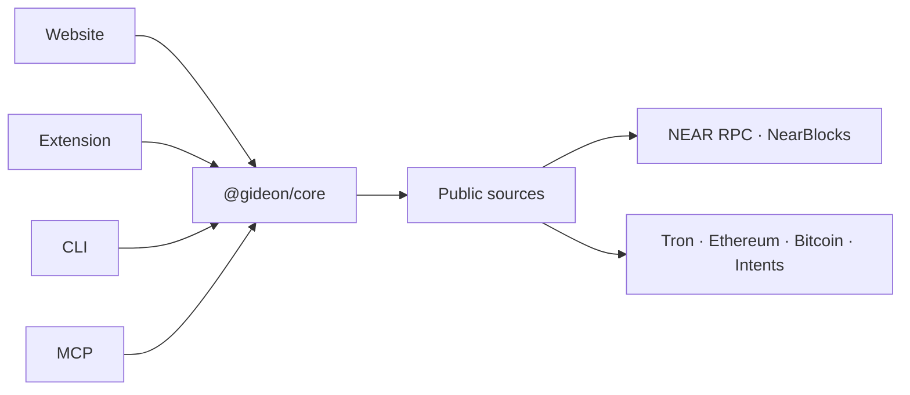

<p></p>

# Gideon

**A pre-send check for NEAR.** Paste the address, token and destination you are about to send to. Gideon checks them against live public chain data and says **BLOCKED**, **LOOK AGAIN** or **NO PROBLEMS FOUND**, in plain words.

Gideon never sees keys and never holds funds. It advises. Your wallet signs. An agent that ignores the advice can still send.


| Light | Dark |
| --- | --- |
|  |  |

## Use it

The website is [gideon-near.vercel.app](https://gideon-near.vercel.app). Docs are at [/docs](https://gideon-near.vercel.app/docs) (`docs.html` when you run it locally).

The extension is not on the Chrome Web Store or Firefox Add-ons. Sideload it:

- [Chrome, Brave, Edge](apps/web/public/downloads/gideon-extension-0.3.1.zip)
- [Firefox](apps/web/public/downloads/gideon-extension-firefox-0.3.1.zip) (unsigned; release Firefox will not install it until it is signed)

Needs Node.js 20.10 or newer. No accounts or API keys.

```bash
npm install
npm test
npm run dev:web          # http://localhost:5173  ·  docs at /docs.html
npm run gideon -- check guest-book.testnet --amount 1
```

Phone browsers and a load-unpacked walkthrough: [apps/extension/README.md](apps/extension/README.md).

## Demos

Nothing is signed. Gideon advises: an agent that ignores `DO_NOT_SEND` can still send. Add `-- --offline` for recorded answers and no network.

```bash
npm run demo:agent
npm run demo:attack -- --offline
npm run demo:function-call-key -- --offline
```

`demo:attack` reads a planted invoice for `northwind-payrol1.testnet` (one character off a saved contact) and stops on **BLOCKED** / **DO_NOT_SEND**.

`demo:function-call-key` holds one `ft_transfer` key on `wrap.testnet`. The allowance is gas, not a cap on the token. It refuses Transfer and AddKey, then stops on that same payee.


## How it’s built



The same rules run in the browser, the extension, the CLI and the MCP server. They only read public APIs.


## Honest limits

No problems found means these checks passed on live data. It is not proof of who controls the account. A lookup that fails is look again, never a pass. A deposit on the wrong chain, for the wrong token, or past its deadline is blocked. A daily spend cap, instruction-like text in a memo, and a saved contact whose address changed are look again. Account health says what each key can do before you remove it. The plain-language guide is on [Docs](https://gideon-near.vercel.app/docs).

## More

- Extension: [apps/extension/README.md](apps/extension/README.md)
- Agent tools: [packages/mcp/README.md](packages/mcp/README.md)
- Flag registry (not deployed): [contracts/flag-registry/README.md](contracts/flag-registry/README.md)

[MIT](LICENSE)
