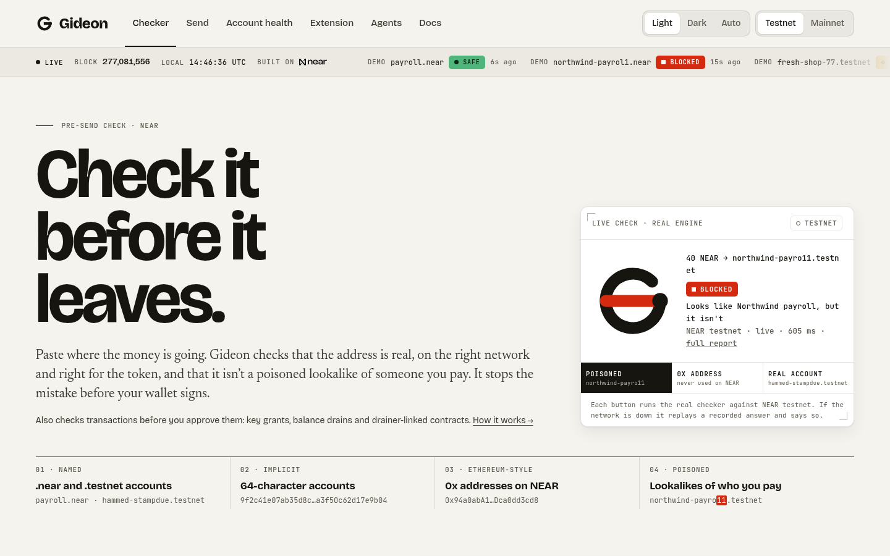
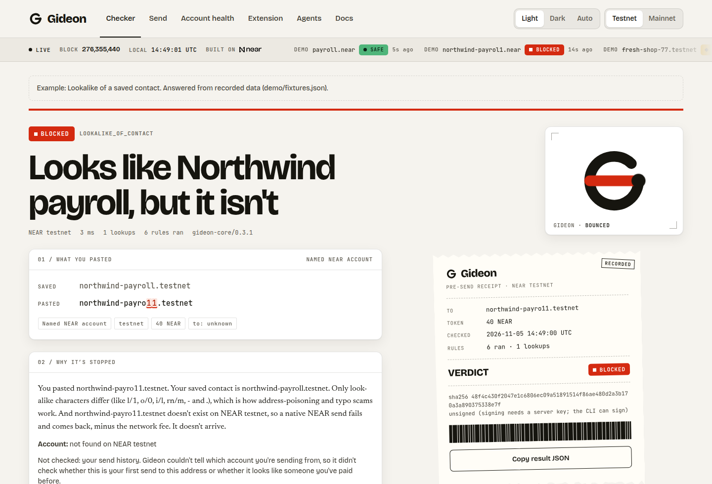
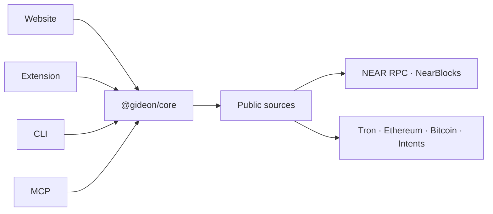
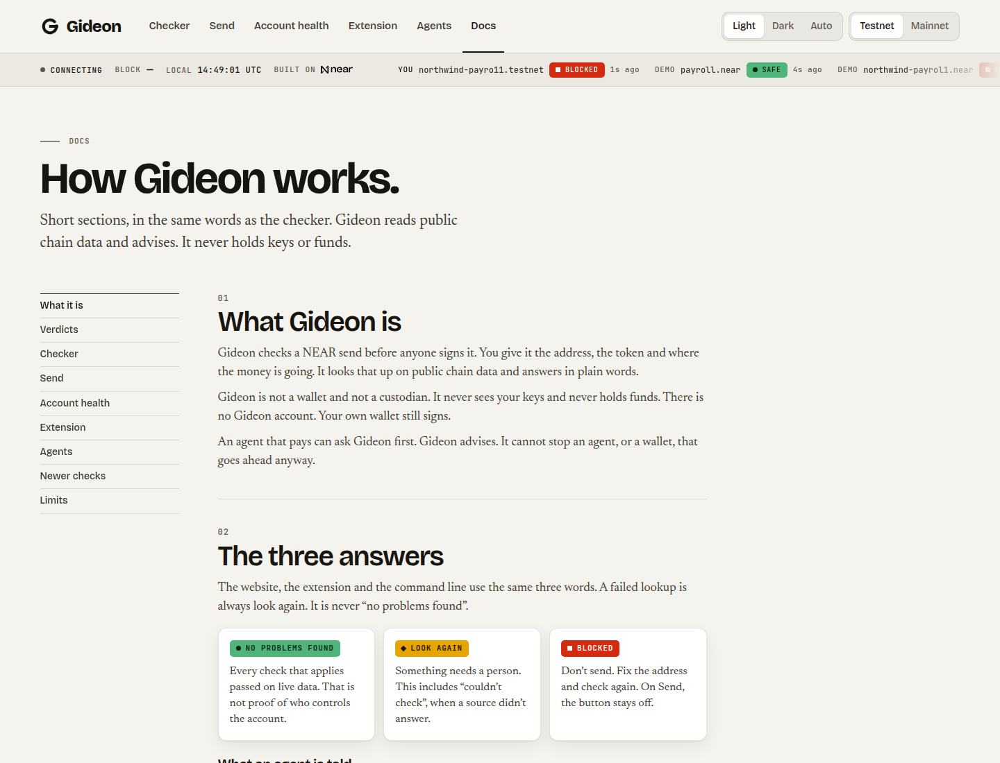

<p></p>

# Gideon

**A pre-send check for NEAR.** Paste the address, token and destination you are about to send to. Gideon checks them against live public chain data and says **BLOCKED**, **LOOK AGAIN** or **NO PROBLEMS FOUND**, in plain words.

Gideon never sees keys and never holds funds. It advises. Your wallet signs. An agent that ignores the advice can still send.



| Light | Dark |
| --- | --- |
|  |  |

## Use it

The website is [gideon-near.vercel.app](https://gideon-near.vercel.app). Docs are at [/docs](https://gideon-near.vercel.app/docs) (`docs.html` when you run it locally).

The extension is not on the Chrome Web Store or Firefox Add-ons. Sideload it:

- [Chrome, Brave, Edge](apps/web/public/downloads/gideon-extension-0.3.1.zip)
- [Firefox](apps/web/public/downloads/gideon-extension-firefox-0.3.1.zip) (unsigned; release Firefox will not install it until it is signed)

Needs Node.js 20.10 or newer. No accounts or API keys.

```bash
npm install
npm test
npm run dev:web          # http://localhost:5173  ·  docs at /docs.html
npm run gideon -- check guest-book.testnet --amount 1
```

Phone browsers and a load-unpacked walkthrough: [apps/extension/README.md](apps/extension/README.md).

## Demos

Nothing is signed. Gideon advises: an agent that ignores `DO_NOT_SEND` can still send. Add `-- --offline` for recorded answers and no network.

```bash
npm run demo:agent
npm run demo:attack -- --offline
npm run demo:function-call-key -- --offline
```

`demo:attack` reads a planted invoice for `northwind-payrol1.testnet` (one character off a saved contact) and stops on **BLOCKED** / **DO_NOT_SEND**.

`demo:function-call-key` holds one `ft_transfer` key on `wrap.testnet`. The allowance is gas, not a cap on the token. It refuses Transfer and AddKey, then stops on that same payee.



## How it’s built



The same rules run in the browser, the extension, the CLI and the MCP server. They only read public APIs.



## Versions

The product on the site and in the download zips is **0.3.1**. That is the extension manifest, the website copy, the receipt engine line `gideon-core/0.3.1`, and the files `gideon-extension-0.3.1.zip` and `gideon-extension-firefox-0.3.1.zip`. Those names stay so the Docs and Extension links keep working.

The unpublished workspace packages (this repo, `@gideon/core`, `@gideon/sources`, `@gideon/cli`, `@gideon/mcp`, and the website) stay at **0.1.0**. They are not published: the npm scope `@gideon` is already taken. The MCP server reports `0.1.0` for that reason. It runs the same engine as the 0.3.1 site and extension.

There is no 0.3.2 release. A few tests and comments say “0.3.2” for follow-ups that shipped inside 0.3.1. Those are labels, not a second version.

## Honest limits

No problems found means these checks passed on live data. It is not proof of who controls the account. A lookup that fails is look again, never a pass. A deposit on the wrong chain, for the wrong token, or past its deadline is blocked. Instruction-like text in a memo, and a saved contact whose address changed, are look again. Account health says what each key can do before you remove it.

The MCP daily spend tally (R21) is process-local and advisory. That server keeps an in-memory map of NEAR this process has already cleared to SEND. The day is UTC. The map resets when the process restarts. Each instance has its own map. Repeating a successful check counts again. It is not an account-wide limit, and it is not what the chain shows was sent. The CLI does not keep that map: a cap applies to the check you are running, plus `--spent` if you pass it. No cap set means the check does not apply.

Gideon advises. An agent can ignore the answer and still send. A block holds only when the wallet, or the other code that signs, refuses the send.

The extension can hold Send on a web page when the check is blocked, and other buttons in that form whose label starts with Withdraw, Transfer, Confirm, Continue, Next, Submit, Pay, or Review. It does not hold Approve. Wallet extension pop-ups (Meteor, Sender, and Nightly sealed windows) are outside the content script, so Gideon cannot read them.

The Send page sends native NEAR. That check-then-send flow was tried with a mock wallet, not with a live Meteor, HOT, or Intear wallet.

The community flag registry is not deployed. That check stays off by default. There is no live community scam database.

A sha256 receipt is the integrity of the printed result. It is not proof the underlying checks were performed honestly, and it is not an attestation. Receipts made on the website are unsigned.

The plain-language guide is on [Docs](https://gideon-near.vercel.app/docs).

## More

- Extension: [apps/extension/README.md](apps/extension/README.md)
- Agent tools: [packages/mcp/README.md](packages/mcp/README.md)
- Flag registry (not deployed): [contracts/flag-registry/README.md](contracts/flag-registry/README.md)

## Glassbox

Glassbox is a public TEE/registration auditor for NEAR AI-agent contracts by the same builder (Adelekejr): [https://github.com/Adelekejr/Glassbox](https://github.com/Adelekejr/Glassbox). Hackathon screening question Q-015 asks for that sibling to be named. Gideon is pre-send payment safety. Glassbox says what was registered and which keys can change the account. They are independent and do not share a verdict.

[MIT](LICENSE)
