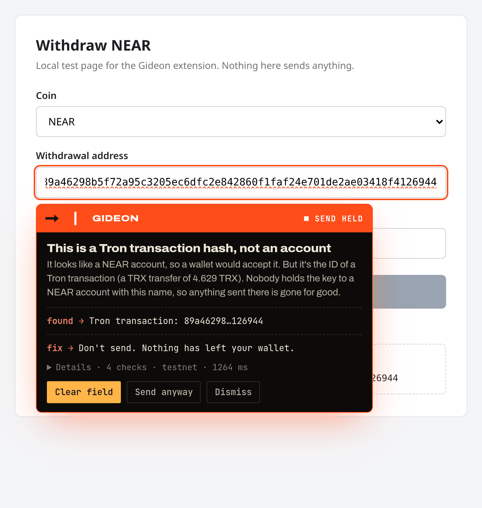

# Gideon

**A pre-send safety check for NEAR.** Paste the address, token and
destination you're about to send to. Gideon checks them against live,
public chain data and says **BLOCKED**, **ATTENTION** or **SAFE**, with the
reason in plain words and how to fix it. Gideon never sees keys and never
holds funds. On the website's **Send** page your own NEAR wallet signs the
transfer, and only after the check.

Work began 29 Oct 2026.


## What it catches

| Mistake | Example | Verdict |
| --- | --- | --- |
| A transaction hash pasted as an account | a Tron tx hash looks like a 64-hex NEAR implicit account, and wallets accept it | BLOCKED |
| Wrong network | a `.near` name while sending on testnet, or a Tron `T…` address | BLOCKED |
| Wrong token for an Intents deposit | sending wNEAR to a 1Click deposit address that expects USDC | BLOCKED |
| Lookalike of a saved contact | `northwind-payro11.testnet` instead of `northwind-payroll.testnet` | BLOCKED |
| A token the exchange may not credit | wNEAR or USDC (NEP-141) sent to an exchange deposit | ATTENTION |
| A fresh Ethereum-style `0x` account | it exists only once someone uses it with an Ethereum key | ATTENTION |
| A lookup that failed | any source is down or rate-limited | ATTENTION ("couldn't check") |

All the examples above are real cases in [`demo/cases.json`](demo/cases.json).

## Quickstart

Needs Node.js 20.10 or newer. No accounts or API keys.

```bash
npm install                 # also builds packages/core, packages/sources, packages/cli
npm test                    # offline unit tests (no network needed)
npm run verify              # the 8 demo cases, replayed from recorded real responses
npm run verify -- --live    # the same 8 cases against the live, free APIs

# check one send from the terminal (testnet is the default)
npm run gideon -- check hammed-stampdue.testnet --amount 1
npm run gideon -- check 89a46298b5f72a95c3205ec6dfc2e842860f1faf24e701de2ae03418f4126944 \
  --network mainnet --dest exchange --exchange binance --json

# the website, on http://localhost:5173
npm run dev:web
npm run build:web           # static build in apps/web/dist

# the Chrome extension
npm run build:extension     # unpacked build in apps/extension/dist
npm run zip:extension       # apps/extension/gideon-extension-0.1.0.zip

# the community flag registry contract (Rust; see "Community flag registry")
cd contracts/flag-registry && cargo test
```

CLI exit codes: `0` SAFE, `1` ATTENTION (including "couldn't check"),
`2` BLOCKED, `64` usage error. So a script can stop on anything that isn't `0`.

## How it works


The same engine runs in three places today: the CLI, the website (in your
browser, straight against the public APIs) and your own code
(`import { check } from "@gideon/core"`).

## The rules

| Rule | Checks | Data |
| --- | --- | --- |
| R1 Format & network | Is it a valid NEAR account, and for the network you chose? Catches `.near` on testnet, Tron and Bitcoin addresses. | local |
| R2 Pasted hash | Is this 64-hex string really a Tron, Ethereum, Bitcoin or NEAR transaction hash? | TronGrid, Ethereum RPC, mempool.space, NEAR RPC |
| R3 Account on chain | Does the account exist? Is it new, or a contract? | NEAR RPC |
| R4 Ethereum-style account | A `0x` + 40 hex address used on NEAR: in use, or never used? | NEAR RPC |
| R5 Token | Is the token real, not a lookalike, and is the receiver registered with it? | NEAR RPC, token list |
| R6 Intents deposit | For a 1Click deposit address: does the token match what it expects, is it still open? | 1Click `/v0/status` (mainnet) |
| R7 Lookalike | Close to a saved contact, or to a recent dust sender (address poisoning)? | your contacts, NearBlocks |
| R8 Exchange | Will this exchange credit this token? Never BLOCKED from registry data alone. | `packages/core/data/exchanges.json` |
| R9 Clipboard | Is what was pasted what you copied? | the extension (copies made on the same page) |
| R10 Community flags | Has anyone flagged this account as a scam or poisoning address? ATTENTION at most, never BLOCKED. | `get_flags` view call on the flag registry contract (off until it's deployed) |

How a verdict is reached:

- Any rule that says **BLOCKED** makes the verdict BLOCKED.
- Otherwise, any **ATTENTION**, or any lookup that failed, makes it ATTENTION.
- **SAFE** only when every rule that applies passed on live data.
- A failed lookup is reported as **"couldn't check"** with the error. It is
  never treated as safe.

Every result carries a receipt: a sha256 over the exact input, findings and
verdict. With `GIDEON_RECEIPT_KEY` set, it's also ed25519-signed and
`gideon verify-receipt result.json` checks it.

## Browser extension (Chrome, Load unpacked)

Gideon is not on the Chrome Web Store. Install it from this repo:

1. `npm install`, then `npm run build:extension`.
2. Open `chrome://extensions` and turn on **Developer mode** (top right).
3. Click **Load unpacked** and pick the `apps/extension/dist` folder.
4. Pin Gideon from the puzzle-piece menu. It starts on **testnet**; switch to
   mainnet in the popup.

`npm run zip:extension` also writes `apps/extension/gideon-extension-0.1.0.zip`.
To install from the zip, unzip it and load that folder the same way. Works in
Chrome 111+ and other Chromium browsers (Edge, Brave, Arc).

What it does:

- **On a send or withdrawal page**, when you paste (or type) into a field that
  looks like a recipient address, it checks the value and shows the night-watch
  warning under the field: vermilion only for STOPPED, amber for "look again"
  and "couldn't check", green for "looks right". On STOPPED it holds the page's
  Send / Withdraw button until you clear the field or choose **Send anyway**.
- **Clipboard check (R9).** It remembers what you copied on the page and
  compares it with what you paste. If a page script swaps the address while
  you copy, it warns at once.
- **Address book.** Save addresses from the popup or from a green warning.
  They stay in `chrome.storage.local` on your device and feed the lookalike
  check (R7).
- **Popup.** Check a send by hand (recipient, token, amount, destination),
  see the last check made on a page, and turn each guard on or off.



More: [popup](shots/extension-popup.png),
[looks right](shots/extension-warning-safe.png),
[couldn't check](shots/extension-warning-couldnt-check.png),
[clipboard swapped on copy](shots/extension-clipboard-tamper-copy.png) and
[on paste](shots/extension-clipboard-tamper.png). They were taken in
Playwright's Chromium on the local test page `apps/extension/test-page/withdraw.html`
(`node apps/extension/scripts/screenshots.mjs`).

## Check, then send (website)

`send.html` (**Send** in the top bar) connects a NEAR wallet with
[NEAR Connect](https://github.com/hot-dao/near-connect)
(`@hot-labs/near-connect`) and only lets it send after Gideon has checked the
exact recipient, amount and network:

1. **Connect** a wallet. NEAR Connect lists the wallets that support the
   network (on testnet: Meteor, Intear, Nightly, Ledger and others).
2. **Check.** Enter the recipient and amount. Gideon runs the full check,
   with the connected account as the sender (so R7 compares the recipient
   with your own history) and your saved contacts as the address book.
3. **Send.** The button follows the verdict:

| Verdict | Send button |
| --- | --- |
| SAFE | enabled: your wallet opens to sign the NEAR transfer |
| ATTENTION (including "couldn't check") | disabled until you tick "I read why Gideon flagged this and I still want to send" |
| BLOCKED | disabled, with no override. Fix the address and check again. |
| not checked, or edited since the check | disabled ("Send (check first)") |

Changing the recipient, amount or account resets the check and the
confirm. The transfer goes to the account the check normalised, for exactly the
amount checked. Nothing is sent without your wallet's own signing prompt.

**Testnet by default.** The Send page's network is fixed at build time:
`VITE_GIDEON_SEND_NETWORK=mainnet npm run build:web` builds it for mainnet
(the top-bar network menu doesn't change it, so a wallet connection can't
switch networks mid-flow).


More: [connect](shots/send-1-connect.png), [safe](shots/send-2-safe.png),
[blocked (address poisoning)](shots/send-4-blocked.png) and
[sent](shots/send-5-sent.png). They were taken with a **mock wallet** injected
into the page and mocked chain answers, so no real transaction was signed or
sent. The same script asserts the gating (SAFE sends, ATTENTION needs the
confirm, BLOCKED never sends, one transfer for the checked amount):
`npm run build:web && node apps/web/scripts/send-screenshots.mjs` (needs
`playwright-core` and its Chromium).

## Community flag registry (contract)

[`contracts/flag-registry`](contracts/flag-registry) is a small NEAR contract
(Rust, `near-sdk` 5.30, built with `cargo-near`) that holds a public list of
community flags against scam and address-poisoning accounts. R10 reads it.

| Method | Who | What |
| --- | --- | --- |
| `report({account_id, reason})` | anyone, with a deposit | Adds your flag. The reason is 1 to 280 bytes. Attach about 0.01 NEAR: it pays for the storage used (0.00001 NEAR per byte, usually under 0.005 NEAR) and the rest is refunded. |
| `withdraw({account_id})` | the reporter | Removes your own flag and refunds its storage deposit. |
| `get_flags({account_id})` | anyone, view call, no key | The flags on that account: `[{reporter, reason, at_ms}]`. |

Anti-spam: one flag per reporter per account, no flagging your own account,
the storage deposit, and at most 100 flags per account. There is **no owner,
no admin key and no init call**: nobody can edit or delete someone else's
flag. Once it's deployed, deleting the contract account's full-access key
locks the code too.

Build and test (Rust 1.95 is pinned in `rust-toolchain.toml`):

```bash
cd contracts/flag-registry
cargo test --lib                            # unit tests
cargo test --test sandbox                   # builds the wasm and runs it on a local near-sandbox
cargo near build non-reproducible-wasm      # target/near/gideon_flag_registry.wasm
```

**Not deployed yet.** To deploy it to testnet later (with the
[NEAR CLI](https://github.com/near/near-cli-rs)):

```bash
near account create-account fund-myself flags.hammed-stampdue.testnet '2 NEAR' \
  autogenerate-new-keypair save-to-keychain sign-as hammed-stampdue.testnet \
  network-config testnet sign-with-keychain send
cd contracts/flag-registry
cargo near deploy build-non-reproducible-wasm flags.hammed-stampdue.testnet \
  without-init-call network-config testnet sign-with-keychain send
```

Then turn R10 on by setting `flagRegistry` for testnet in
[`packages/core/src/networks.ts`](packages/core/src/networks.ts). Until then
R10 is skipped. To try a registry without changing code: `--registry <contract>`
(or `GIDEON_FLAG_REGISTRY`) on the CLI, or `check(input, sources, { flagRegistry })`
in code. If the registry account has no contract (or the call fails), R10
says **"couldn't check"**, never "no flags".

## Testnet and mainnet

One config ([`packages/core/src/networks.ts`](packages/core/src/networks.ts))
covers both. **Testnet is the default.** To switch:

| Where | How |
| --- | --- |
| CLI | `--network mainnet`, or `GIDEON_NETWORK=mainnet` |
| Code | `check({ ..., network: "mainnet" }, liveSources())` |
| Website | the network menu in the top bar (remembered in your browser), or `?net=mainnet` in the URL |
| Send page | `VITE_GIDEON_SEND_NETWORK=mainnet` when building the website |
| R10 registry | `flagRegistry` per network in `networks.ts`, `--registry` / `GIDEON_FLAG_REGISTRY` on the CLI |

NEAR Intents (1Click) has no testnet, so R6 always reads mainnet.

## Optional adapters (off by default)

Gideon runs with none of these. Copy `.env.example` to `.env` (or export the
variables) to turn one on.

| Adapter | Variables | What changes |
| --- | --- | --- |
| Paid or private NEAR RPC | `GIDEON_RPC_URL_MAINNET`, `GIDEON_RPC_URL_TESTNET`, `GIDEON_RPC_API_KEY` | used instead of the free FastNEAR endpoints |
| NEAR AI explainer | `NEARAI_API_KEY`, `NEARAI_MODEL` (default `z-ai/glm-5.2`) | rewrites the reason in plainer words through NEAR AI Cloud. It only rephrases: it can never change the verdict, and if it fails the built-in text is used. |
| Signed receipts | `GIDEON_RECEIPT_KEY` (make one with `npm run gideon -- keygen`) | receipts are ed25519-signed as well as hashed |

## Repo layout

```
packages/core      rule engine, verdicts, receipts, network config, token and exchange data
packages/sources   free, no-key data sources, plus replay for offline tests
packages/cli       the gideon command
apps/web           the website (Vite, static): Checker, Send (check, then send), Extension preview, Agents preview
apps/extension     Chrome MV3 extension: popup, in-page warning, clipboard check, address book
contracts/flag-registry  Rust contract for community flags (R10)
packages/mcp       MCP server scaffold for AI agents (README only; not built yet)
demo               the 8 real cases and their recorded responses
shots              screenshots of the website, the Send flow and the extension
```

The website deploys as a static site; `vercel.json` builds it with
`npm run build:web` into `apps/web/dist`.

## Honest limits

- **Free APIs have limits.** NearBlocks' free tier allows about 6 calls a
  minute, and TronGrid and the public RPCs can rate-limit or go down. When
  that happens Gideon says "couldn't check", not safe. Use the paid RPC
  adapter if you need more.
- **Exchange data is a starter list.** Only the generic rule ("most exchanges
  credit native NEAR only") is confirmed from a public source. Per-exchange
  entries are marked unverified, and R8 never blocks on them.
- **Intents checks are mainnet only**, because 1Click has no testnet.
- **The MCP server is not built yet.** The website's Agents page shows the
  planned behaviour with the real engine running live.
- **The extension is Chrome-only and unpacked.** It is not on the Chrome Web
  Store and has no Firefox build. It was tested in Playwright's Chromium on a
  local test page, not yet on real wallet or exchange sites, whose fields may
  be labelled in ways it doesn't recognise.
- **The extension only knows the address.** It doesn't read the token,
  amount or destination from the page, so on-page checks run as "NEAR to an
  unknown destination". Token and exchange checks (R5, R6, R8) need the popup,
  the website or the CLI.
- **The content script runs on every http(s) page** so it can work on any
  wallet or exchange. It acts only on recipient-looking fields and
  address-shaped values, and sends only that value to the extension's own
  background worker, which calls the free APIs. Nothing goes to a Gideon server.
- **The clipboard check (R9) only sees copies made on the same page**, while
  that tab stays in front. Copies from other apps, `navigator.clipboard`
  writes and clipboard malware on your computer aren't visible to it, so then
  R9 is skipped, not passed.
- **R10 is off until the flag registry is deployed.** The contract is built
  and tested on a local sandbox only. Until it's deployed and set in
  `networks.ts`, R10 is skipped.
- **Community flags are reports, not proof.** Anyone with a few cents of
  NEAR can flag an account, and one person can use many accounts. That's why a
  flag only raises ATTENTION, shows who flagged and why, and never blocks.
  A flagged account can't remove the flags, and reporters can withdraw their
  own. There is no moderation.
- **The Send page was tested with a mock wallet only.** No real wallet has
  signed or sent a transaction through it yet. It sends native NEAR only
  (no tokens, no Intents), with one transfer per check.
- **A busy NearBlocks makes sends harder, not riskier.** The Send page reads
  your history to catch lookalikes. If NearBlocks is rate-limited, the check
  says "couldn't check" and Send needs your confirm.
- **Lookalike checks need something to compare against**: your saved
  contacts (website and extension: stored only in your browser) or
  `--book`/`--from` on the CLI.
- **Receipts on the website are unsigned**, because signing needs a key and
  the website has no server. The CLI can sign.
- Gideon checks for known mistakes. A SAFE verdict means none of these rules
  fired on live data; it is not a guarantee about who controls the account.

## Built with

- **Code:** TypeScript, Vite (website and extension bundles), Vitest and
  happy-dom (tests), `@noble/hashes` and `@noble/ed25519` (receipts),
  Playwright (screenshots and the Send-page mock-wallet test).
- **NEAR:** NEAR Connect (`@hot-labs/near-connect`, wallet selector on the
  Send page). The flag registry uses Rust, `near-sdk`, `cargo-near`, and
  `near-sandbox` + `near-api` for its sandbox test. Fonts: Archivo and JetBrains Mono (SIL Open
  Font License), bundled in the extension.
- **Free, no-key APIs:** FastNEAR RPC (testnet and mainnet), NearBlocks API,
  NEAR Intents 1Click API, TronGrid, PublicNode Ethereum RPC and
  mempool.space. NEAR AI Cloud is an optional adapter, off by default.

Built with help from Grok Bot (AI coding assistant).

## License

[MIT](LICENSE)
